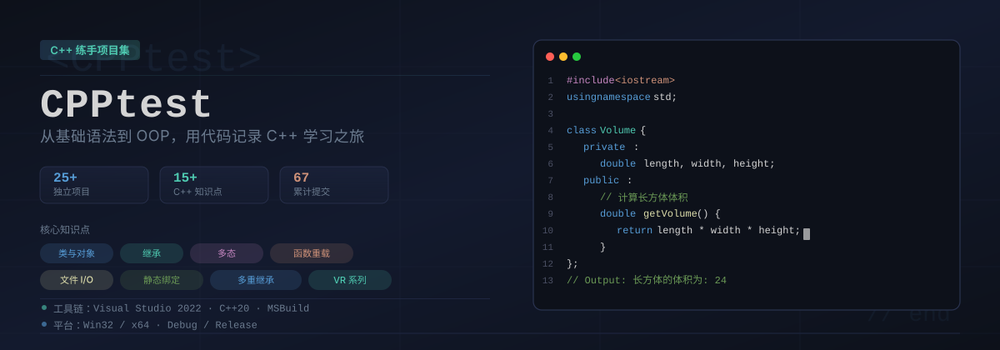

<p align="center">
  
</p>

<div align="center">

<!-- 石墩徽章 -->
<a href="https://stone.professorlee.work/stone/NoNameLeGo/CPPtest">
  
</a>

</div>

---

## 🎯 这是什么？

**CPPtest** 是一个 C++ 学习练手项目的合集仓库。这里存放了我在学习 C++ 过程中写下的 **25+ 个独立项目**，覆盖了从基础语法到面向对象编程的核心知识点。

> 每个项目都是一个独立的控制台应用程序，有各自的 `main()` 和 `vcxproj` 构建文件，互不依赖。

---

## 📂 项目分类一览

### 🧱 基础语法

| 项目 | 描述 |
|------|------|
| [Volume](./Volume) | 长方体体积计算 — 类的基本定义、构造函数、成员函数 |
| [BMI](./BMI) | BMI 指数计算 — 基础输入输出与数学运算 |
| [Counter](./Counter) | 计数器类 — 静态成员、多文件结构 |
| [20260317](./20260317) | 函数比较四个数大小 — 函数定义与参数传递 |
| [overloading](./overloading) | 函数重载 — 计算不同图形的面积 |

### 🏗️ 类与对象

| 项目 | 描述 |
|------|------|
| [Time](./Time) | 时间类 — 类设计、指针访问成员 |
| [Class](./Class) | 多文件结构 — `.h` / `.cpp` 分离、类外定义函数 |
| [Avatar](./Avatar) | 角色属性 — 默认参数减少代码量，避免定义多个重载版本 |
| [BankAccount](./BankAccount) | 银行账户系统 — 封装、数据隐藏、交易记录追踪 |
| [DiscountProduct](./DiscountProduct) | 打折商品计算 — 组合与价格策略 |

### 🧬 继承

| 项目 | 描述 |
|------|------|
| [Inheritance](./Inheritance) | 初学类继承 — 基类与派生类的基本用法 |
| [Animal](./Animal) | 动物继承体系 — 多层继承结构 |
| [Shape](./Shape) | 形状层次结构 — 继承体系设计与多态 |
| [Postgraduate](./Postgraduate) | 研究生类 — 继承与派生类实际应用 |
| [20260428multiple_inheritance_test](./20260428multiple_inheritance_test) | 多重继承 — 同时继承多个基类 |

### 🔄 多态与静态绑定

| 项目 | 描述 |
|------|------|
| [TestStatic](./TestStatic) | 静态成员深入 — 静态变量、静态函数 |
| [student_graduate_static_binding](./student_graduate_static_binding) | 静态绑定演示 — 编译期函数调用解析 |
| [Pay](./Pay) | 支付系统 — 多态应用 |
| [PayMethod](./PayMethod) | 支付方式 — 多态接口设计 |
| [Role](./Role) | 角色系统 — 多态在实际场景中的使用 |
| [GameObject](./GameObject) | 游戏对象系统 — 面向对象游戏设计 |

### 🥽 VR 主题系列

| 项目 | 描述 |
|------|------|
| [VRCharacter](./VRCharacter) | VR 角色 — 角色属性与行为封装 |
| [VRHeadset](./VRHeadset) | VR 头显 — 设备类建模 |
| [VRObject](./VRObject) | VR 物体 — 3D 物体距离计算 |
| [VRExperience](./VRExperience) | VR 体验 — 体验流程建模 |
| [VRWeapon](./VRWeapon) | VR 武器 — 武器系统设计 |

### 📊 数据结构

| 项目 | 描述 |
|------|------|
| [SeqListBasic](./SeqListBasic) | 顺序表基础 — 静态数组模拟、初始化、批量赋值与遍历 |
| [SeqListOps](./SeqListOps) | 顺序表核心操作 — 指定位置插入、删除、按值查找、元素移动观察 |
| [SeqListMenu](./SeqListMenu) | 顺序表综合应用 — 菜单驱动、模块化函数设计 |

### 📁 文件 I/O

| 项目 | 描述 |
|------|------|
| [data](./data) | 浮点数组文件读写 — `ofstream` / `ifstream` 实现数据持久化 |
| [20260528VRObjectIO](./20260528VRObjectIO) | VR 场景二进制 I/O — 结构体序列化与反序列化 |

---

## 🔥 亮点项目

### 💰 BankAccount — 银行账户系统
封装、数据隐藏、交易记录追踪 —— 一个完整的面向对象案例。

```cpp
class BankAccount {
private:
    string accountHolderName;
    string accountNumber;
    double balance;
    string lastTransactionType;
public:
    void deposit(double amount);
    bool withdraw(double amount);
    void displayBalance();
};
```

### 🥽 VR 系列 — 趣味主题练手
用 VR 主题串联多个知识点：类设计、继承、多态、文件 I/O。

| 子项目 | 练习重点 |
|--------|----------|
| VRCharacter | 类封装与属性管理 |
| VRObject | 3D 坐标计算与距离公式 |
| 20260528VRObjectIO | 结构体二进制序列化 |

### 📁 20260528VRObjectIO — 二进制文件 I/O
将 `VRObject` 结构体以二进制形式写入场景文件，再读取还原：

```cpp
struct VRObject {
    int id;
    float x, y, z;
    char name[50];
};

ofstream fout("vr_scene.dat", ios::binary);
fout.write((char*)objects, sizeof(objects));
fout.close();
```

---

## 🚀 快速构建

### 环境要求

- **IDE:** Visual Studio 2022
- **工具集:** `v143` (VS 2022)
- **语言标准:** C++20 (`/std:c++20`)
- **构建系统:** MSBuild

### 编译运行

在 **开发者命令提示符** 或 **PowerShell** 中：

```powershell
# 编译单个项目（Debug / Win32）
msbuild Volume\Volume.vcxproj

# 指定配置与平台
msbuild Avatar\Avatar.vcxproj /p:Configuration=Release /p:Platform=x64

# 运行
.\x64\Release\Avatar.exe
```

> ⚠ 本仓库没有 `.sln` 解决方案文件，请直接打开各项目目录下的 `*.vcxproj` 或在命令行用 MSBuild 编译。

---

## 📚 学习路径

```
基础语法 ─→ 类与对象 ─→ 继承 ─→ 多态/静态绑定 ─→ 文件 I/O
  ├ Volume     ├ Time       ├ Inheritance  ├ TestStatic     ├ data
  ├ BMI        ├ Class      ├ Animal       ├ Pay            └ 20260528VRObjectIO
  ├ Counter    ├ Avatar     ├ Shape        ├ PayMethod
  ├ overloading├ BankAccount├ Postgraduate ├ Role
  └ 20260317   └ DiscountProduct└ 多重继承   └ GameObject
                                              └ VR 系列
```

---

## 📜 License

本项目基于 [Apache-2.0](./LICENSE.txt) 许可证开源。

---

## Star History

<a href="https://www.star-history.com/?repos=NoNameLeGo%2FCPPtest&type=date&legend=top-left">
 <picture>
   <source media="(prefers-color-scheme: dark)" srcset="https://api.star-history.com/chart?repos=NoNameLeGo/CPPtest&type=date&theme=dark&legend=bottom-right" />
   <source media="(prefers-color-scheme: light)" srcset="https://api.star-history.com/chart?repos=NoNameLeGo/CPPtest&type=date&legend=bottom-right" />
   
 </picture>
</a>
